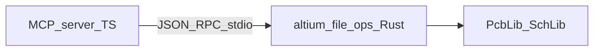

# File-mode (without Altium running)

## Current status

The published `altium-mcp` server focuses on the **live bridge**: DelphiScript
inside Altium Designer, driven via `request.json` / `response.json`.

Offline manipulation of library files is a deliberate extension point:

- Use MCP tool **`file_mode_capabilities`** to see flags for this build.
- See [packages/file-ops/README.md](../packages/file-ops/README.md) for integration notes.

## Suggested architecture

## Risks

Writing binary Altium formats incorrectly can corrupt libraries. Prefer read-only
tools first, snapshot files before write tools, and test on copies.
